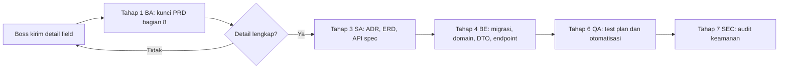

# PRD — IAM Service

> Bahasa Indonesia (hanya dokumen ini yang boleh berbahasa Indonesia per standar `team-workflow`).
>
> Dokumen ini mencakup kebutuhan bisnis layanan Identity and Access Management (IAM) yang telah
> diimplementasikan dalam Package A (Fase 1–6) serta Paket Hardening Keamanan v1.1.0 (2026-11-16).
> Tujuan PRD ini adalah menjadi Single Source of Truth untuk Tahap 1 hingga Tahap 7 alur `team-workflow`.

---

## 1. Ringkasan Eksekutif

IAM Service adalah layanan identitas dan akses berbasis token JWT untuk mengelola pengguna, peran
(RBAC), dan akses ke sistem lain. Layanan ini menyediakan autentikasi, kontrol akses berbasis peran,
jejak audit berkeamanan, sesi per perangkat, rotasi kunci JWT, serta agregat penolakan 401.

Paket A (Fase 1–6) adalah cakupan fitur yang telah disetujui dan diimplementasikan, termasuk
multi-tenancy (isolasi logis per organisasi, header `X-Organization-ID`) dan structured logging
(logging terstruktur dengan kategori) yang diadopsi pada 2026-11-14 melalui ADR-0016 dan ADR-0017.

Versi `1.1.0` (2026-11-16) menambahkan **paket hardening keamanan** di atas fondasi Package A:
binding klaim `tenant_id` pada access token terhadap tenant hasil resolusi header (ADR-0019),
penegakan `token_type=access` pada decoder (refresh token tidak lagi bisa dipakai sebagai Bearer),
pembatasan `GET /v1/audit-logs/verify` ke peran `OPS` (V12), serta HTTPS in-app di production
(TLS dengan CA internal, service `iam.osprey.service`). Lihat §3.10 dan §6.

Paket A **tidak termasuk** rate limit terdistribusi, pencabutan access token, WORM eksternal,
SAML/OIDC, atau pendaftaran mandiri.

Catatan 2026-11-16 — arah cloud (shared multi-tenant SaaS) sedang dieksplorasi, **belum ada
tenant konkret dan belum ada perubahan scope yang diimplementasikan**. Keputusan hasil diskusi
dicatat di §4 dan §7, serta di `docs/adr/0020` (provisioning Fase 1) dan `docs/adr/0021`
(peran kustom per tenant — tidak diadopsi).

---

## 2. Masalah yang Dipecahkan

- Organisasi perlu layaman identitas terpusat untuk mengelola pengguna dan akses ke sistem lain.
- Kebutuhan kontrol akses berbasis peran (RBAC) dengan audit trail yang dapat diverifikasi.
- Kebutuhan manajemen sesi per perangkat agar satu perangkat bisa dicabut tanpa mematikan yang lain.
- Kebutuhan deteksi pemakaian ulang token refresh sebagai indikasi pencurian token.
- Kebutuhan visibilitas lonjakan penolakan 401 (401 aggregate) setelah instance restart.
- Kebutuhan monitoring dan alerting berbasis Prometheus untuk operasional production.
- Cegah penyalahgunaan token sah lintas tenant: header `X-Organization-ID` dikontrol pemanggil, sementara klaim `tenant_id` pada token tidak pernah diverifikasi → token tenant A bisa dipakai beroperasi di tenant B.
- Cegah refresh token (TTL 7 hari) dipakai sebagai Bearer credential ke endpoint terautentikasi (token_type tidak diverifikasi).
- Cegah kebocoran metadata lintas tenant pada verifikasi rantai audit publik-internal (audit chain bersifat global).

---

## 3. Cakupan Fitur (Package A / Fase 1–6 + Paket Hardening v1.1.0)

### 3.1 Autentikasi & Token

| Fitur | Detail |
|-------|--------|
| JWT HS256 | Access token 15 menit, refresh token 7 hari |
| Refresh token hash | Simpan hash SHA-256, bukan token mentah |
| Rotasi refresh token | Token lama dicabut saat ditukar, token baru terbit |
| Deteksi pemakaian ulang | Token yang dicabut oleh rotasi tapi sesi masih hidup → `REFRESH_TOKEN_REUSE`, cabut seluruh sesi pengguna |
| Rotasi kunci JWT | `kid` pada header, `JWT_SECRET` + `JWT_SECRET_PREVIOUS` selama transisi |
| Token tanpa `kid` | Diterima selama kunci sebelumnya dikonfigurasi |

### 3.2 Pengguna & Peran (RBAC)

| Fitur | Detail |
|-------|--------|
| Manajemen pengguna | Buat, baca, perbarui, hapus, aktifkan, nonaktifkan |
| Manajemen peran | Buat, baca, hapus peran (`ADMIN`, `AUDITOR`, `USER`) |
| Penggantian peran | Admin bisa mengganti seluruh peran milik pengguna |
| Ganti kata sandi | Pemilik atau admin |
| Reset kata sandi | Admin tanpa kata sandi lama |
| Kunci akun otomatis | 5 kali gagal → kunci 15 menit, dihitung per akun |

### 3.3 Sesi Per Perangkat

| Fitur | Detail |
|-------|--------|
| Sesi per login | Setiap login buat satu baris `sessions` dengan id UUID stabil |
| Klaim `session_id` | Token akses dan refresh membawa klaim `session_id` |
| Daftar perangkat | `GET /v1/auth/sessions` hanya sesi milik pemanggil, penanda `current` |
| Pencabutan satu sesi | `DELETE /v1/auth/sessions/{id}`, sesi orang lain 404 |
| Logout | Cabut sesi token yang dikirim + seluruh refresh token di dalamnya |
| Label perangkat | `deviceLabel` opsional, 100 karakter, dari klien (bukan identitas) |

### 3.4 Jejak Audit

| Fitur | Detail |
|-------|--------|
| Rantai hash | Setiap baris audit terikat ke sebelumnya lewat hash (trigger database) |
| Verifikasi rantai | `GET /v1/audit-logs/verify` melaporkan entri rusak pertama; sejak 2026-11-16 dibatasi untuk peran `OPS` (ADMIN/AUDITOR → 403) |
| Aksi tercatat | Login, logout, refresh, ganti kata sandi, ganti role, aktif/nonaktif, pencabutan massal |
| `TOKENS_REVOKED` | Pencabutan massal dengan aktor dan jumlah token |
| `SESSION_REVOKED` | Pencabutan lewat `DELETE /v1/auth/sessions/{id}` |
| `ACCESS_DENIED` | 403 dengan jejak audit, aktor, dan URI |
| 401 tidak di-audit | Tidak disimpan ke audit_logs (hindari flood oleh pemanggil tidak teridentifikasi) |

### 3.5 Agregat Penolakan 401

| Fitur | Detail |
|-------|--------|
| Tabel agregat | `security_rejection_stats` per menit, method, alasan |
| Alasan | `missing_credentials` atau `invalid_token` |
| Tanpa path/IP | Tidak disimpan, hanya di log WARN |
| Upsert | `ON CONFLICT`, increment counter per menit |
| Pembersihan | Tugas berulang berdasarkan retensi (default 30 hari) |
| Tidak gagal respons | Database error hanya dicatat log, caller tetap terima 401 |

### 3.6 Monitoring & Alerting (Prometheus)

| Fitur | Detail |
|-------|--------|
| Registry Prometheus | `micrometer-registry-prometheus`, expose `/actuator/prometheus` |
| Tanpa token | Scraper tidak perlu refresh access token 15 menit |
| Jaringan internal | Endpoint wajib hanya dijangkau internal scraper |
| Aturan alert | `ops/prometheus/alerts.yml` (down, 5xx, 401 spike, 403 spike, heap, pool) |
| Tes integrasi | `PrometheusEndpointIntegrationTest` mengunci nama metrik |

### 3.7 Multi-Tenancy (ADR-0016)

| Fitur | Detail |
|-------|--------|
| Isolasi data | Shared database/schema, kolom `tenant_id` di tabel inti (`users`, `sessions`, `refresh_tokens`, `audit_logs`, `security_rejection_stats`) |
| Organisasi | Setiap tenant memiliki `tenant_id` internal dan `organization_id` eksternal (header `X-Organization-ID`) |
| Header organisasi | `X-Organization-ID` diekspos ke klien; `TenantHeaderFilter` me-resolve ke `tenant_id` internal |
| Identitas tenant-scoped | Username dan email unik per tenant: `UNIQUE(tenant_id, username)` dan `UNIQUE(tenant_id, email)` (diputuskan 2026-11-14, menggantikan constraint unik global) |
| Kontrak login | `POST /v1/auth/login` dan `POST /v1/auth/refresh` **wajib** `X-Organization-ID` (breaking contract v1.0.0, 2026-11-14) |
| Binding token ↔ tenant | Pada semua endpoint terautentikasi kecuali login/refresh, klaim `tenant_id` pada access token harus sama dengan tenant hasil resolusi header; mismatch → 401 (`tenant_mismatch`) — diadopsi 2026-11-16 (ADR-0019) |
| Peran | Tabel `roles` tetap global (`ADMIN`, `AUDITOR`, `USER`, `MANAGER`, `OPS`) |
| On-premise | Satu tenant `org-default`; header boleh default ke sana |
| Cloud | Banyak tenant dalam satu deployment bersama |

### 3.8 Structured Logging (ADR-0017)

| Fitur | Detail |
|-------|--------|
| Lima kategori | `errors` (galat/kegagalan), `generals` (peristiwa umum), `integrations` (integrasi eksternal), `timers` (durasi operasi), `emails` (pengiriman email — belum aktif, tetap dispesifikasikan) |
| Format | Structured logging ke stdout, satu event per baris; trace/span id diset via MDC |
| Tenant | Setiap entry membawa `tenant_id` bila tersedia |
| Retensi | Dikelola oleh platform log (mis. Loki/ELK), bukan di aplikasi |

### 3.9 Operasional & Deployment

| Fitur | Detail |
|-------|--------|
| Docker multi-stage | JRE 21, user non-root 10001:10001, profil prod |
| Backup/restore | Skrip bash dengan `pg_dump`/`pg_restore`, mode container |
| Uji restore CI | `.github/workflows/restore-drill.yml` cadangkan → hapus → pulihkan → verifikasi |
| CODEOWNERS | Pemilik untuk seluruh repo dan path sensitif |
| cspell | Konfigurasi ejaan untuk dokumentasi Bahasa Inggris |
| Provisioning tenant (Fase 1) | Endpoint OPS-only untuk membuat tenant dan bootstrap ADMIN pertama; idempoten, tervalidasi, dan tercatat di audit (ADR-0020, ADR-0023) |

---

### 3.10 Paket Hardening Keamanan (v1.1.0, 2026-11-16)

| Fitur | Detail |
|-------|--------|
| Binding token ↔ tenant | Klaim `tenant_id` pada access token wajib sama dengan tenant hasil resolusi `X-Organization-ID` pada setiap endpoint terautentikasi kecuali `/v1/auth/login` dan `/v1/auth/refresh` (refresh menambatkan ke tenant tersimpan, ADR-0018 poin 6); mismatch → 401 `tenant_mismatch` (ADR-0019) |
| Jenis token | Resource server menolak token dengan `token_type` selain `access`; refresh token (TTL 7 hari) tidak dapat dipakai sebagai Bearer |
| Verifikasi rantai audit → OPS | `GET /v1/audit-logs/verify` dibatasi peran `OPS`; ADMIN/AUDITOR → 403. Peran global `OPS` ditambahkan oleh migrasi V12 (tidak diberikan ke user mana pun otomatis); akun operasional dibuat manual per deployment |
| Retensi agregat 401 menyeluruh | Pembersihan `security_rejection_stats` kini berlaku untuk semua tenant (sebelumnya hanya `org-default` akibat fallback pada thread penjadwal) |
| HTTPS in-app | TLS terminated di aplikasi (`server.ssl.*`), tanpa reverse proxy; sertifikat dari CA internal (`Osprey Internal CA`), SAN `DNS:iam.osprey.service`, valid hingga 2029-02-18; port 9090 hanya melayani HTTPS (request HTTP → 400) |
| DNS & trust store | Klien harus resolve `iam.osprey.service` → host (DNS override router) dan mempercayai CA internal (import root cert sekali per klien) |
| Konteks tenant tanpa warisan thread | `TenantContext` tidak lagi diwariskan ke child thread (`InheritableThreadLocal` → `ThreadLocal`) |
| Penolakan header tercatat | 401 missing/unknown organisasi dicatat ke log WARN, metrik `iam.security.rejected`, dan agregat per menit (sebelumnya tidak tercatat) |

## 4. Batasan yang Diketahui (Package A tidak mencakup)

- Rate limit terdistribusi (hanya per instance)
- Pencabutan access token secara langsung (access token berlaku hingga kadaluwarsa)
- WORM / penyimpanan append-only eksternal untuk jejak audit
- Integrasi SAML atau OIDC
- Pendaftaran mandiri (self-registration)

Keputusan dan batasan hasil diskusi cloud 2026-11-16 (belum ada tenant konkret; masih eksplorasi):

- **Peran tetap global** (`ADMIN`, `AUDITOR`, `USER`, `MANAGER`, `OPS`); **tidak ada peran kustom per tenant**. Izin/peran yang khusus untuk aplikasi tenant dikelola oleh aplikasi tenant masing-masing, bukan oleh IAM ini (ADR-0021)
- **Multi-organisasi dalam satu akun** belum ada; satu akun terikat satu tenant (ADR-0018)
- **Email belum aktif**: tidak ada lupa password mandiri maupun verifikasi email; reset password hanya oleh admin (kategori `emails` di §3.8 masih belum aktif)
- **Eksposur cloud publik wajib berada di balik WAF/API gateway**; rencana Cloudflare, vendor final diputuskan saat deployment cloud pertama yang nyata; rate limit per instance di §4 tidak cukup untuk internet publik
- **Tooling provisioning tenant Fase 1 dibangun di revisi ini**; onboarding cloud tetap admin-provisioned — tenant dibuat dan ADMIN pertama di-bootstrap oleh tim OPS lewat endpoint OPS-only (ADR-0020, ADR-0023). Self-registration tetap ditunda ke Fase 2.
- **Self-registration** ditunda ke Fase 2 bersyarat (lihat §7)
- **Operator OPS adalah tim**, bukan orang tunggal: beberapa akun OPS per deployment, dengan grant/revoke dan serah-terima terdokumentasi (`docs/07-DEPLOYMENT.md` §13); cloud via tim OPS default-org, on-premise via DBA (SQL langsung)

Multi-tenancy dan structured logging **sudah masuk ruang lingkup** pada 2026-11-14 (diimplementasikan lewat ADR-0016 dan ADR-0017). Paket hardening keamanan (§3.10) masuk ruang lingkup pada 2026-11-16 (ADR-0019, migrasi V12, TLS).

---

## 5. Kriteria Terima (Acceptance Criteria)

- [ ] Semua endpoint `/v1` teruji dengan integrasi Testcontainers PostgreSQL 16
- [ ] Cakupan kode minimal 80 persen per kelas (JaCoCo)
- [ ] Checkstyle 0 pelanggaran
- [ ] SpotBugs ambang Medium lolos
- [ ] SBOM CycloneDX 1.6 dihasilkan pada `verify`
- [ ] Trivy memindai image Docker (HIGH/CRITICAL dengan perbaikan)
- [ ] Docker image build berhasil dan berjalan sebagai non-root
- [ ] Uji restore otomatis di CI lolos
- [ ] Prometheus scrape mengembalikan metrik yang diharapkan
- [ ] Identitas tenant-scoped: `UNIQUE(tenant_id, username)` dan `UNIQUE(tenant_id, email)` pada database target
- [ ] `POST /v1/auth/login` dan `POST /v1/auth/refresh` menolak permintaan tanpa `X-Organization-ID` (400/401)
- [ ] Isolasi lintas tenant terverifikasi otomatis (pengguna tenant A tidak melihat data tenant B)
- [ ] Binding token ↔ tenant: request dengan token tenant A + header `X-Organization-ID: tenant-b` ditolak **401 `tenant_mismatch`** (ADR-0019, `TenantBindingIntegrationTest`)
- [ ] Resource server menolak token dengan `token_type` selain `access` (refresh token tidak bisa dipakai sebagai Bearer)
- [ ] `GET /v1/audit-logs/verify` → **403** untuk `ADMIN`/`AUDITOR`, **200** untuk `OPS` (V12)
- [ ] Migrasi **V12** (seed role `OPS`) tercatat sukses di `flyway_schema_history`
- [ ] HTTPS aktif di production; request HTTP plain ditolak (400)
- [ ] Isolasi tenant pada verify: hanya akun `OPS` yang dapat membaca verifikasi rantai lintas tenant
- [ ] `POST /v1/tenants` → **201** untuk tenant baru, **200** untuk `organization_id` yang sama (idempoten), **403** untuk peran selain `OPS`
- [ ] `POST /v1/tenants/{organizationId}/bootstrap-admin` → **201** untuk ADMIN pertama, **200** untuk pengulangan, **404** untuk organisasi tidak dikenal, **403** untuk non-OPS
- [ ] Aksi `TENANT_PROVISIONED` tercatat di `audit_logs` beserta actor dan `organization_id`

## 6. Rilis

Versi saat ini: **`1.2.0`** (2026-11-20, belum dirilis) — Phase 1 provisioning tenant (ADR-0020, ADR-0023): endpoint OPS-only `POST /v1/tenants` dan `POST /v1/tenants/{organizationId}/bootstrap-admin`, serta `GET /v1/tenants/current`. Versi produksi aktif tetap `1.1.3`.

Versi sebelumnya: **`1.1.0`** (2026-11-16) — Package A + **Paket Hardening Keamanan** (§3.10):
binding klaim `tenant_id` ↔ tenant hasil resolusi header (ADR-0019), penegakan `token_type=access`,
pembatasan `GET /v1/audit-logs/verify` ke peran `OPS` (V12), dan HTTPS in-app (CA internal,
`iam.osprey.service`). Deployed ke host LAN 2026-11-16 dengan rollback exercise terbukti
(1.1.0 → 1.0.1 → 1.1.0). Grade rilis: **A-** (`docs/07-DEPLOYMENT.md` §12).

Riwayat rilis:
- `1.0.0` (2026-11-14) — Paket A (Fase 1–6) + multi-tenancy ADR-0016/0018 + structured logging ADR-0017
- `1.0.1` (2026-11-14/15) — perbaikan BUG-TENANT-005 + dependensi CI
- `1.1.0` (2026-11-16) — Paket Hardening Keamanan (ADR-0019, V12, TLS)
- `1.2.0` (2026-11-20, belum dirilis) — Phase 1 provisioning tenant; tanpa migrasi database dan tanpa perubahan kontrak lama

PRD ini sebelumnya tertinggal (masih menyebut `0.1.0` dan `[Belum Dirilis]`) — diperbarui pada 2026-11-14,
dan diperbarui lagi pada **2026-11-16** agar sinkron dengan v1.1.0 (`CHANGELOG.md`, `ADR-0019`, `10-PENTEST.md`).

Penambahan scope berikutnya (selain Paket A/v1.1.0) hanya boleh masuk lewat revisi PRD ini
atau ADR baru — bukan dilaksanakan diam-diam di bawah label "perbaikan".

## 7. Pertanyaan Terbuka

Terjawab pada diskusi cloud 2026-11-16:

- [TERJAWAB 2026-11-16] Peran OPS & akun operasional: akun OPS dibuat per deployment (bukan per tenant); operator adalah **tim** dengan beberapa akun dan serah-terima terdokumentasi. Cloud: tim OPS default-org mem-provisioning tenant baru beserta ADMIN pertamanya; on-premise: DBA via SQL langsung. OPS tetap global lintas tenant dan tidak menempel ke organisasi mana pun (`docs/07-DEPLOYMENT.md` §13, ADR-0020).
- [TERJAWAB 2026-11-16] Self-registration: tetap di luar scope. Hanya masuk Fase 2 bila ada demand nyata — pemicu: ≥1 tenant/paying customer meminta onboarding mandiri, atau beberapa prospek meminta hal yang sama. Masuk lewat revisi PRD + ADR baru + threat model + infra email; bukan lewat label "perbaikan".
- [TERJAWAB 2026-11-16] CORS produksi: **same-origin** — frontend dan API dilayani dari domain yang sama (`iam.osprey.service`); tidak ada ACAO lintas origin untuk klien browser publik.
- [TERJAWAB 2026-11-16] Multi-organisasi dalam satu akun: tetap ditunda; lihat daftar terbuka di bawah.

Masih terbuka:

- [TERBUKA] Multi-organisasi dalam satu akun (mis. 1 user = 2 org) — belum ada; model "1 akun = 1 tenant" (ADR-0018). Bila ada requirement nyata, perlu ADR baru (opsi membership `tenant_users`, ADR-0019 Alternative B).
- [TERBUKA] Pemicu kuantitatif Fase 2 self-registration — angka threshold belum ditetapkan; usulan awal: ≥1 tenant nyata meminta onboarding mandiri.
- [TERBUKA] Vendor WAF final (rencana: Cloudflare) — diputuskan saat deployment cloud pertama yang nyata, bersama cloud provider dan anggaran.
- [TERBUKA] Infra email (provider, lupa password mandiri, verifikasi email) — diputuskan bila cloud publik punya demand nyata; hari ini dicatat sebagai batasan (§4).
- [TERJAWAB 2026-11-20] Pembangunan tooling provisioning Fase 1 (ADR-0020) — Boss memerintahkan eksekusi penuh Phase 1 tanpa Phase 2 self-service. Cakupan: endpoint OPS-only, validasi, idempotensi, audit `TENANT_PROVISIONED`, bootstrap ADMIN pertama via endpoint, runbook, dan pengujian (ADR-0023).
- [TERBUKA] Prosedur tertulis grant/revoke dan serah-terima akun OPS (siapa approve, kapan review) — apakah perlu ditambahkan ke `docs/07-DEPLOYMENT.md` §13?

---

## 8. Change Request CR-2026-11-20 — User Info (DRAF, detail menyusul)

> Status: **DITUTUP 2026-11-20**. Pembahasan User Info/HRIS dipindahkan ke project terpisah sesuai keputusan Boss. Bagian ini dipertahankan hanya sebagai catatan riwayat Change Request dan tidak menjadi dasar implementasi di iam-service.

### 8.1 Kondisi Saat Ini — Fakta dari Kode

| Hal | Kondisi saat ini | Sumber |
|-----|------------------|--------|
| Field identitas pengguna | `id`, `tenant_id`, `username`, `email`, `password_hash`, `active`, `failed_login_attempts`, `locked_until`, `created_at`, `updated_at`, `version`, `roles` | `src/main/java/id/osprey/iamservice/domain/user/User.java`, `infrastructure/persistence/UserJpaEntity.java` |
| Tabel penyimpanan | `users` berisi `id`, `username`, `email`, `password_hash`, `active`, `created_at`, `updated_at`; kolom lain ditambahkan migrasi berikutnya | `src/main/resources/db/migration/V1__create_schema.sql`, `V3__add_version_to_users.sql`, `V4__add_auth_and_audit.sql`, `V9__add_tenant_id.sql` |
| Kontrak baca | `GET /v1/users` (ADMIN/AUDITOR) dan `GET /v1/users/{id}` (ADMIN/AUDITOR atau pemilik akun) mengembalikan `UserResponse` berisi `id`, `username`, `email`, `active`, `version`, `roles` | `docs/04-API-SPEC.yaml` |
| Tata kelola perubahan | Penambahan scope hanya boleh lewat revisi PRD atau ADR baru | Bagian 6 dokumen ini |

Belum ada tabel, entity, atau endpoint bernama User Info di repositori saat ini.

### 8.2 Problem Statement

**[PERLU KONFIRMASI]** Boss belum menyampaikan masalah bisnis yang mendorong permintaan ini, pemilik kebutuhan, dan dampak terukur yang diharapkan. Tanpa itu, draf ini tidak boleh dianggap sebagai persetujuan scope. Kalimat berikut adalah templat, bukan fakta:

> **[PERLU KONFIRMASI]** [Peran] mengalami [hambatan] saat [situasi], sehingga [dampak terukur]. Bukti: [sumber data].

### 8.3 Asumsi & Pertanyaan Terbuka

| ID | Pertanyaan | Status | Pemilik |
|----|------------|--------|---------|
| Q-INFO-01 | Field apa saja yang termasuk informasi lengkap User? Tipe data, panjang maksimum, wajib atau opsional, serta formatnya? | **[PERLU KONFIRMASI]** | Boss |
| Q-INFO-02 | Apakah data disimpan di tabel terpisah berelasi 1:1 ke `users`, atau sebagai kolom tambahan pada `users`? | **[PERLU KONFIRMASI]** — Boss memilih menunggu detail | Boss + Tahap 3 |
| Q-INFO-03 | Siapa yang boleh membaca dan mengubah data ini: pemilik akun saja, ADMIN/AUDITOR, atau kombinasi keduanya? | **[PERLU KONFIRMASI]** | Boss |
| Q-INFO-04 | Apakah field ini sensitif sehingga perlu aturan enkripsi, retensi, atau pengecualian dari `GET /v1/users`? | **[PERLU KONFIRMASI]** | Boss + Tahap 3 |
| Q-INFO-05 | Apakah pencarian `q` dan pengurutan pada `GET /v1/users` perlu mencakup field baru? | **[PERLU KONFIRMASI]** | Boss |
| Q-INFO-06 | Apakah perubahan data ini harus tercatat di `audit_logs` dengan aksi baru? | **[PERLU KONFIRMASI]** | Boss |

### 8.4 Kamus Istilah (Glossary)

| Istilah | Padanan teknis | Catatan |
|---------|----------------|---------|
| User Info | `user profile` / `user info` | Nama final menunggu keputusan Tahap 3 |
| Informasi lengkap User | `profile fields` | Daftar field belum ditetapkan |
| Data pribadi | `personal data` | Status sensitivitas menunggu konfirmasi Q-INFO-04 |

### 8.5 Ruang Lingkup MVP (MoSCoW) — DRAF

| Prioritas | Kebutuhan | Alasan | Status |
|-----------|-----------|--------|--------|
| Must | Boss menetapkan daftar field, tipe, batas panjang, dan aturan akses sebelum Tahap 3 dimulai | Tanpa itu kontrak API dan migrasi tidak bisa dikunci | **[PERLU KONFIRMASI]** |
| Should | Data User Info dapat dibaca lewat endpoint yang sudah ada atau endpoint baru menurut kontrak Tahap 3 | Mengikuti pola `UserResponse` yang berlaku | Draf |
| Could | Pencarian dan pengurutan menggunakan field baru | Bergantung pada jawaban Q-INFO-05 | Draf |
| Won't | Perubahan pada `roles`, kata sandi, status `active`, dan mekanisme autentikasi | Fitur ini hanya menambah informasi profil | Draf |

Prioritas di atas belum disetujui dan tidak boleh dipakai sebagai dasar estimasi.

### 8.6 User Stories & Acceptance Criteria (DRAF)

**US-INFO-01** — Sebagai ADMIN atau AUDITOR, saya ingin membaca informasi lengkap User, agar saya dapat memverifikasi identitas pengguna dalam tenant saya.

- Given tenant dan akun dengan peran ADMIN atau AUDITOR sudah terautentikasi serta memiliki `X-Organization-ID` yang cocok,
  When saya meminta User Info untuk satu `id` pengguna,
  Then sistem mengembalikan field yang disetujui di Q-INFO-01 **[PERLU KONFIRMASI]** dan tidak mengembalikan `password_hash`.
- Given pemanggil bukan ADMIN/AUDITOR dan bukan pemilik akun,
  When saya meminta User Info pengguna lain,
  Then sistem menolak dengan 403 menurut aturan akses yang ditetapkan di Q-INFO-03 **[PERLU KONFIRMASI]**.
- Given `id` tidak ditemukan di tenant pemanggil,
  When saya meminta User Info,
  Then sistem mengembalikan 404.

**US-INFO-02** — Sebagai pemilik akun, saya ingin mengubah data profil saya, agar data kontak saya tetap mutakhir.

- Given aturan akses di Q-INFO-03 sudah disetujui **[PERLU KONFIRMASI]**,
  When pemilik akun mengirim perubahan field profil yang valid,
  Then sistem menyimpan perubahan dan mengembalikan data terbaru.
- Given salah satu field melebihi batas panjang atau format yang ditetapkan di Q-INFO-01 **[PERLU KONFIRMASI]**,
  When perubahan dikirim,
  Then sistem menolak dengan 400 dan mencantumkan field yang tidak valid.

Acceptance criteria di atas sengaja belum menyebut nama field, tipe, atau endpoint. Menuliskannya sekarang berarti mengarang kontrak.

### 8.7 Alur Routing Perubahan (Mermaid)

Tahap 2 dan Tahap 5 tidak berlaku karena layanan ini hanya menyediakan REST API.

### 8.8 Dokumen Terdampak (belum diubah)

| Dokumen | Pemilik tahap | Yang akan berubah setelah detail disetujui | Status |
|---------|---------------|--------------------------------------------|--------|
| `docs/01-PRD.md` bagian 8 | Tahap 1 (BA) | Draf ini menjadi kebutuhan final | Ditulis sekarang |
| `docs/03-ARCHITECTURE.md` | Tahap 3 (SA) | Model domain, skema tabel, NFR privasi | Menunggu |
| `docs/04-API-SPEC.yaml` | Tahap 3/4 (SA/BE) | `UserResponse`, request body, endpoint baca dan ubah | Menunggu |
| `docs/08-CODEBASE-MAP.md` | Tahap 4 (BE) | Entity, port, adapter, DTO, controller | Menunggu |
| `docs/06-TEST-PLAN.md` | Tahap 6 (QA) | Skenario positif, negatif, batas, hak akses | Menunggu |
| `docs/07-DEPLOYMENT.md` | Tahap 7 (SEC) | Migrasi produksi dan pemeriksaan keamanan | Menunggu |

Menurut Role Lock, BA dilarang mengubah dokumen Tahap 3 sampai Tahap 7. Daftar di atas hanya catatan dampak, bukan izin edit.

### 8.9 Gate Eksekusi

Tidak ada migrasi, entity, DTO, endpoint, atau test yang ditulis sebelum Q-INFO-01 sampai Q-INFO-06 dijawab dan draf ini disetujui. Persetujuan draf tidak otomatis membuka izin Tahap 3; Boss perlu memberi perintah lanjutan setelah detail diterima.
