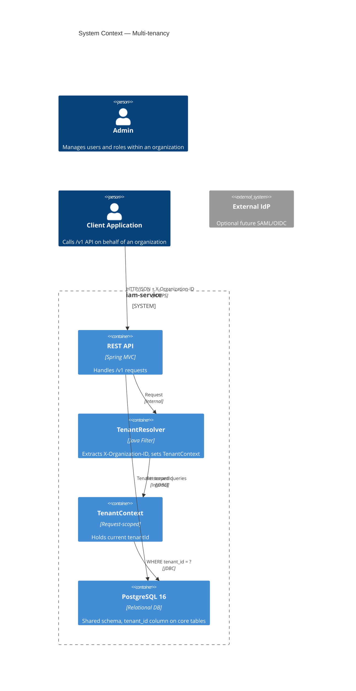
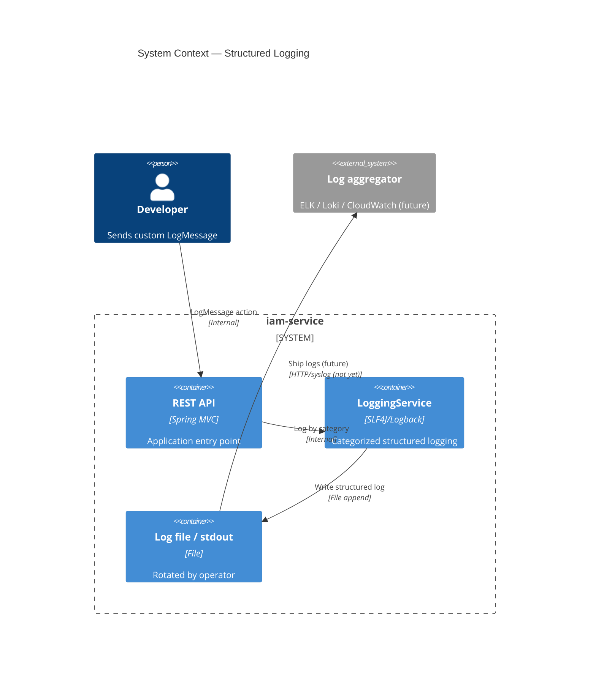

# Architecture Document

> English (technical documentation per `team-workflow` standard).

## 1. Architecture Style

**Clean Architecture / Hexagonal** with strict layer separation:

```
adapter (REST, persistence) -> application (use cases) -> domain (pure business logic)
```

Dependency direction is enforced by `ArchitectureLayerTest`. No framework imports in `domain/`.

## 2. Layer Map

| Layer | Package | Responsibility |
|-------|---------|----------------|
| Domain | `id.osprey.iamservice.domain` | Pure business entities, ports (interfaces), exceptions |
| Application | `id.osprey.iamservice.application` | Use cases, service orchestration |
| Infrastructure | `id.osprey.iamservice.infrastructure` | JPA entities, Spring Data repositories, JDBC adapters |
| Adapter (REST) | `id.osprey.iamservice.adapter.rest` | Controllers, DTOs, exception mapping |
| Config | `id.osprey.iamservice.config` | Security, scheduling, properties, key ring |

## 3. Key Components

### 3.1 Domain

- `domain/auth/Session` — one device login, stable UUID, device label, revoked state, `tenant_id`
- `domain/auth/RefreshToken` — hashed refresh token, session owner, revoked state, `tenant_id`
- `domain/auth/SessionRepository` — port for session storage, tenant-scoped
- `domain/auth/RefreshTokenRepository` — port for refresh token storage, tenant-scoped
- `domain/auth/TokenIssuer` — port for JWT issuance and hashing
- `domain/security/SecurityRejectionStatRepository` — port for 401 rejection aggregate, tenant-scoped
- `domain/user/User`, `domain/user/Role`, `domain/user/UserRepository`, `domain/user/RoleRepository`
- `domain/tenant/Tenant` — organization tenant identity, `tenant_id` internal key
- `domain/tenant/TenantRepository` — port for tenant resolution from external organization ID
- `domain/tenant/TenantContext` — request-scoped holder of current `tenantId`
- `domain/logging/LoggingService` — port for categorized logging: errors, generals, integrations, timers, emails
- `domain/logging/LogCategory` — enum: ERRORS, GENERALS, INTEGRATIONS, TIMERS, EMAILS
- `domain/logging/LogEntry` — structured log entry value object

### 3.2 Application

- `application/auth/AuthService` — login, refresh, logout, list sessions, revoke session, revoke all tokens (tenant-scoped)
- `application/auth/SessionCleanupService` — delete revoked/inactive sessions (tenant-scoped)
- `application/auth/RefreshTokenCleanupService` — delete expired refresh tokens (tenant-scoped)
- `application/auth/RefreshTokenReuseService` — revoke all sessions on token reuse, log `REFRESH_TOKEN_REUSE`
- `application/auth/SessionSummary` — DTO for device list response
- `application/audit/AuditService` — audit logging (transactional and independent)
- `application/security/SecurityRejectionStatsService` — record 401 aggregate, cleanup by retention (tenant-scoped)
- `application/security/PasswordPolicy` — password strength rules
- `application/tenant/TenantResolver` — resolves `X-Organization-ID` header to internal `tenantId`, sets `TenantContext`
- `application/logging/LoggingServiceImpl` — implements `LoggingService`, writes to SLF4J/Logback with MDC
- `application/logging/LogMessage` — developer action to send custom general log message

### 3.3 Infrastructure

- `infrastructure/persistence/SessionJpaEntity` — JPA entity for `sessions` table, `tenant_id` column
- `infrastructure/persistence/RefreshTokenJpaEntity` — JPA entity for `refresh_tokens` table, `tenant_id` column
- `infrastructure/persistence/TenantJpaEntity` — JPA entity for `tenants` table
- `infrastructure/persistence/SessionPersistenceAdapter` — implements `SessionRepository`, tenant-scoped queries
- `infrastructure/persistence/RefreshTokenPersistenceAdapter` — implements `RefreshTokenRepository`, tenant-scoped queries
- `infrastructure/persistence/TenantPersistenceAdapter` — implements `TenantRepository`
- `infrastructure/persistence/SecurityRejectionStatPersistenceAdapter` — implements `SecurityRejectionStatRepository` via JdbcTemplate, tenant-scoped
- `infrastructure/logging/LoggingAdapter` — SLF4J/Logback adapter, MDC injection of `tenantId` and `traceId`

### 3.4 REST Adapter

- `adapter/rest/AuthController` — login, refresh, logout, sessions list, revoke session (requires `X-Organization-ID`)
- `adapter/rest/WebMapper` — shared web-to-domain translator (actor ID, session ID, pagination, tenant ID)
- `adapter/rest/TenantHeaderFilter` — extracts `X-Organization-ID`, delegates to `TenantResolver`

### 3.5 Config

- `config/SecurityConfig` — filter chain, permit `/v1/auth/login`, `/v1/auth/refresh`, `/actuator/health`, `/actuator/prometheus`
- `config/RestAuthenticationEntryPoint` — 401 handling, reason classification, WARN log + metric
- `config/RestAccessDeniedHandler` — 403 handling, audit `ACCESS_DENIED`, WARN log + metric
- `config/SecurityEventRecorder` — records security events to log, metric, and audit
- `config/JwtKeyRing` — key rotation with `kid`, current + previous key
- `config/IamProperties` — all `iam.*` configuration properties
- `config/SessionCleanupJob`, `config/RefreshTokenCleanupJob`, `config/SecurityRejectionStatsCleanupJob` — scheduled tasks (tenant-scoped)
- `config/LoggingConfig` — Logback appenders, MDC pattern, structured output

## 4. Security Controls

- JWT HS256, access TTL 15 min, refresh TTL 7 days
- Refresh tokens stored as SHA-256 hash
- `kid` = first 8 bytes of SHA-256 of key, hex
- `JWT_SECRET_PREVIOUS` accepted during key rotation
- CSRF disabled (stateless bearer token)
- CORS explicit origins, no wildcard
- HSTS, frame-ancestors 'none', CSP for Swagger UI (dev only)
- Rate limit per IP on auth endpoints, account lock after 5 failures
- 401 not written to audit_logs (avoid flood); 403 written to audit_logs

## 5. Non-Functional Requirements

| NFR | Value |
|-----|-------|
| Test coverage | ≥ 80% line per class (JaCoCo) |
| Checkstyle | 0 violations |
| SpotBugs | Medium threshold, per-class exclusions |
| SBOM | CycloneDX 1.6 JSON on `verify` |
| Docker | Multi-stage, JRE 21, user 10001:10001, prod profile |
| Scheduling pool | 4 threads (4 cleanup tasks) |

## 6. Multi-tenancy

### 6.1 Design

Internal implementation uses `tenant_id` (consistent across code, database, domain).
External API contract uses `X-Organization-ID` header for business-friendly terminology.

A `TenantResolver` extracts `X-Organization-ID` from the request header, resolves it to
an internal `tenantId` via `TenantRepository`, and stores it in request-scoped
`TenantContext`. All repository queries for core tables (`users`, `roles`,
`sessions`, `refresh_tokens`, `audit_logs`, `security_rejection_stats`) are filtered
by `WHERE tenant_id = :currentTenantId`.

**Identity is tenant-scoped (ADR-0018, 2026-11-14):** `users.username` and
`users.email` are unique **per tenant** — `UNIQUE(tenant_id, username)` and
`UNIQUE(tenant_id, email)`. Login lookups match within the resolved tenant; a
request without a known organization cannot authenticate.

Role master rows (`ADMIN`, `AUDITOR`, `USER`) remain global (no `tenant_id`) to avoid
replication. Tenant-specific roles can be added later if required.

### 6.2 Diagram (C4 Level 2 — Container)



### 6.3 Security implications

- `X-Organization-ID` **required** on every tenant-aware endpoint, **including**
  `/v1/auth/login` and `/v1/auth/refresh` (ADR-0018). Missing header → `401 Unauthorized`
  on login/refresh; `400 Bad Request` is kept only on the already-locked sessions/logout
  contract. Unknown organization → `401 Unauthorized` on every path (Boss ruling
  2026-11-14, BUG-TENANT-001: reject, never fall back to `org-default`).
- Tenant-scoped identity means `admin` in `org-a` and `admin` in `org-b` are distinct
  accounts with distinct credential sets; a shared global username is not permitted.
- Tenant A cannot access Tenant B data; enforced at repository layer, tested via integration tests

## 7. Structured Logging

### 7.1 Design

Logging is implemented via existing SLF4J/Logback (no new dependency). A `LoggingService`
domain port defines five categories:

| Category | Purpose | Status |
|----------|---------|--------|
| `errors` | Unhandled exceptions, system errors, custom error messages | Implemented |
| `generals` | General messages, custom `LogMessage` action from developers | Implemented |
| `integrations` | External REST API request/response, inbound and outbound | Implemented |
| `timers` | Background job execution: started, success, failed, timeout | Implemented |
| `emails` | SMTP send status: success, failure, trouble | Scaffold only (deferred) |

Every log record includes `tenantId` (from `TenantContext` via MDC) and `traceId`
(from OpenTelemetry when sampling enabled). Output is structured JSON or `key=value`
to stdout/file. Log rotation and retention are operator-managed.

### 7.2 Diagram (C4 Level 2 — Container)



## 8. Non-Functional Requirements

| NFR | Value | Status |
|-----|-------|--------|
| Test coverage | ≥ 80% line per class (JaCoCo) | Existing |
| Checkstyle | 0 violations | Existing |
| SpotBugs | Medium threshold, per-class exclusions | Existing |
| SBOM | CycloneDX 1.6 JSON on `verify` | Existing |
| Docker | Multi-stage, JRE 21, user 10001:10001, prod profile | Existing |
| Scheduling pool | 4 threads (4 cleanup tasks) | Existing |
| Tenant isolation | Repository-enforced `tenant_id` filter | Adopted (ADR-0016) |
| Logging categories | 5 categories: errors, generals, integrations, timers, emails | Adopted (ADR-0017) |
| Logging output | Self-managed stdout/file, structured | Adopted |
| Tenant-scoped identity | `UNIQUE(tenant_id, username)` and `UNIQUE(tenant_id, email)`; required `X-Organization-ID` on `/v1/auth/login` + `/v1/auth/refresh` | Adopted (ADR-0018) |

## 9. Known Limits

- Rate limit is per instance (no distributed rate limiting in Package A)
- Access tokens are not revocable directly (expire after 15 minutes max)
- No WORM / append-only external audit storage
- No SAML/OIDC, no self-registration
- Multi-tenancy is logical isolation (`tenant_id` column), not physical; a repository filter bug can leak data across tenants (mitigated by tests)
- Logging is local per instance; no central aggregator yet
- Email logging category is scaffold only; SMTP implementation deferred
